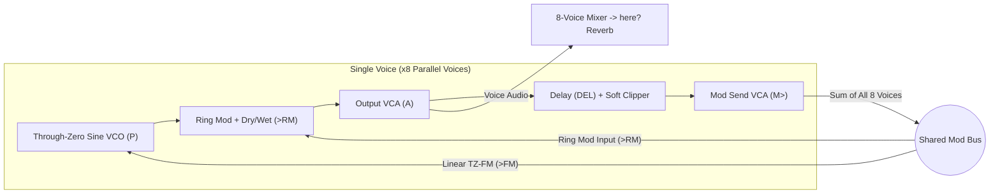

# Paradox

**Paradox** is a standalone DSP firmware for the [Hermetic Modular Alchemy Lab](https://hermeticmodular.com/modules/alchemy-lab) (V2) — a faithful recreation of the Reaktor community ensemble *h e i s h e r e* by Lazyfish.

Paradox pairs an 8-voice cross-coupled FM/RM feedback synthesizer (`who is` / `it?he is`) with an 8-voice stereo cross-coupled exponential delay reverb and per-voice dynamic Automatic Gain Control (AGC) leveler (`here?`), plus stereo external audio blending.

## Features

- **8-Voice Coupled FM/RM Feedback Synth (`who is`):** Six dual-layer (`VaR` / `RnD`) parameters (`A`, `P`, `>RM`, `>FM`, `M>`, `DEL`) with deterministic hash-seeded per-voice dispersion, live seed re-rolling on `RnD` turns, and 3-second per-voice feedback delay lines.
- **8-Voice Exponential Stereo Reverb & AGC (`here?`):** Cross-coupled left/right comb delay tank (up to 10 seconds per voice) with stereo asymmetry, in-loop 1-pole TPT high-pass and low-pass damping, per-voice envelope-dividing leveler, and external audio crossfade (`Mix`).
- **Compositional LED Feedback:** Live 8-voice hash scatter, shimmer, re-seed sparkle bursts, smooth sub-LED `VaR` comet, and unobtrusive catch indicators on Page 1; Electric Violet rings on Page 2.
- **16 QSPI Preset Slots:** Pre-seeded at first boot with 16 factory presets, B2 tap-to-cycle with a 1-second K1–K6 slot overlay, B2 1.5 s hold-to-overwrite, persistent boot-slot memory across power cycles, and full [HostLink Web Programmer](https://hermeticmodular.com/program) support.
- **Modulation & Performance:** Six bipolar ±5 V CV inputs mapped to the six `who is` `VaR` parameters, plus looping parameter locks via **B1 + knob**.

## Control Surface

### Buttons

| Button | Action | Function |
| --- | --- | --- |
| **B1** | Tap | Cycle between Page 1 (`who is`) and Page 2 (`here?`) |
| **B1** | Hold + turn knob | Record or clear a looping parameter lock |
| **B2** | Tap | Load next preset slot (1–16) with 1 s K1–K6 segment readout |
| **B2** | Hold (1.5 s) | Overwrite the active preset slot in QSPI flash |
| **B3** | Tap | Toggle Page 1 between `VaR` (Phosphor Lime) and `RnD` (Crimson Orange) |
| **B2 + B3** | Hold | Open Alchemy Lab Settings (brightness & preset gesture UI) |

### Knobs

| Knob | Page 1 (`who is` — `VaR` / `RnD`) | Page 2 (`here?` — Reverb) |
| --- | --- | --- |
| **K1** (Top Left) | `A` / `A RND` (Amplitude) | `SizE` (0.0 – 4.0) |
| **K2** (Top Right) | `P` / `P RND` (Pitch) | `AsyM` (-4.0 – +4.0) |
| **K3** (Middle Left) | `>RM` / `>RM RND` (Ring Mod) | `Decay` (0 – 100) |
| **K4** (Middle Right) | `>FM` / `>FM RND` (FM Index) | `Mix` (0.0 = synth, 1.0 = external audio) |
| **K5** (Bottom Left) | `M>` / `M> RND` (Mod Bus Send) | `HP` (0 – 127) |
| **K6** (Bottom Right) | `DEL` / `DEL RND` (Feedback Delay) | `LP` (0 – 130) |

### Jacks

| Jacks | Signal | Function |
| --- | --- | --- |
| **J1 / J2** | Audio In L / R | Mono-summed external audio input blended into `here?` via `Mix` |
| **J3 – J8** | CV In (Bipolar ±5 V) | Modulates `A`, `P`, `>RM`, `>FM`, `M>`, and `DEL` (`VaR`) |
| **J9 / J10** | Audio Out L / R | Stereo output from the `here?` reverb and dynamic leveler |

## 8 Voice Feedback Architecture

Paradox's tone generator runs **8 parallel voices** coupled through a single shared modulation bus. Each voice can be thought of as a self-modulating Eurorack voice patched like this:



## Project Structure

```text
├── Makefile                 Daisy / Alchemy Lab V2 build rules
├── CMakeLists.txt           IDE / clangd symbol indexing configuration
├── src/
│   ├── paradox.cpp          Hardware wiring, pages, knobs, LED rings, CV, presets
│   ├── paradox_dsp.h/.cpp   8-voice FM/RM feedback synth & exponential FDN reverb
│   ├── paradox_palette.h    LED color palette definitions
│   └── paradox_snapshots.h  16 default factory presets
└── lib/
    ├── alchemy-sdk/         Alchemy framework & V2 board support (submodule)
    └── libDaisy/            Electrosmith Daisy library (submodule)
```

## Requirements

- `git`
- `make`
- `arm-none-eabi-gcc`
- `dfu-util`
- `node` (optional, for `make program-live` via HostLink)

Ubuntu / Debian:

```sh
sudo apt install git make gcc-arm-none-eabi dfu-util
```

macOS (Homebrew):

```sh
brew install git make dfu-util
brew install --cask gcc-arm-embedded
```

## Building

```sh
git clone --recurse-submodules <repo-url>
cd paradox

make libdaisy    # build libDaisy once after cloning
make             # build firmware -> build/paradox.bin
```

## Flashing

Connect the Alchemy Lab front-panel USB-C port, then flash via one of:

- **DFU mode:** Press or hold **B3** during the ~2 s boot comet window until the rings breathe slowly, then run:
  ```sh
  make program-dfu
  ```
- **Live reboot & flash (no button press required):** Close any open WebSerial tab connected to the module, then run:
  ```sh
  make program-live
  ```
- **Browser:** Upload `build/paradox.bin` with the [Hermetic Modular Web Programmer](https://hermeticmodular.com/program).

## License

MIT — see [LICENSE](LICENSE). `alchemy-sdk` and `libDaisy` are independently MIT-licensed by their respective authors.
